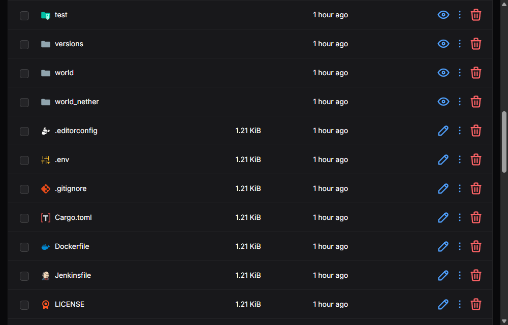
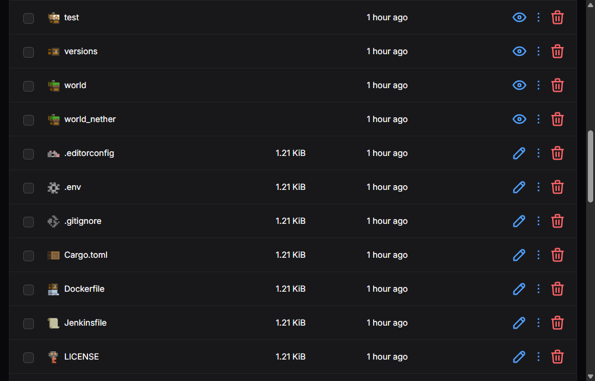
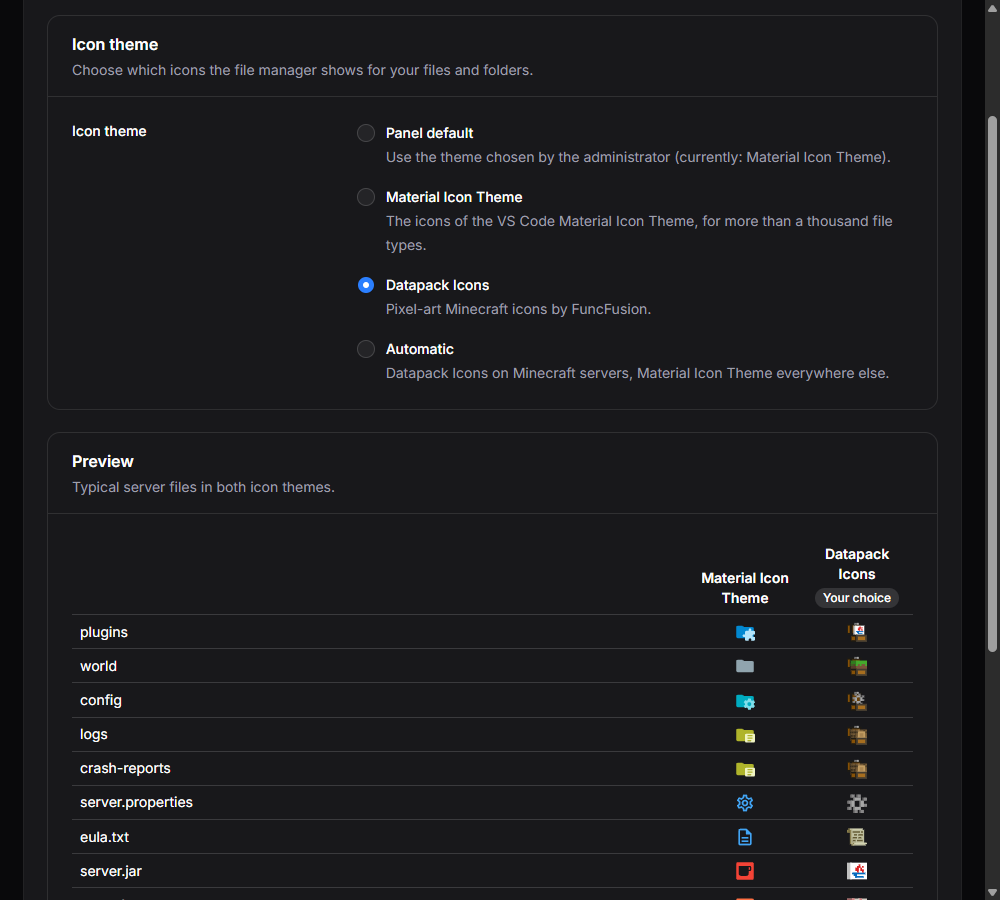
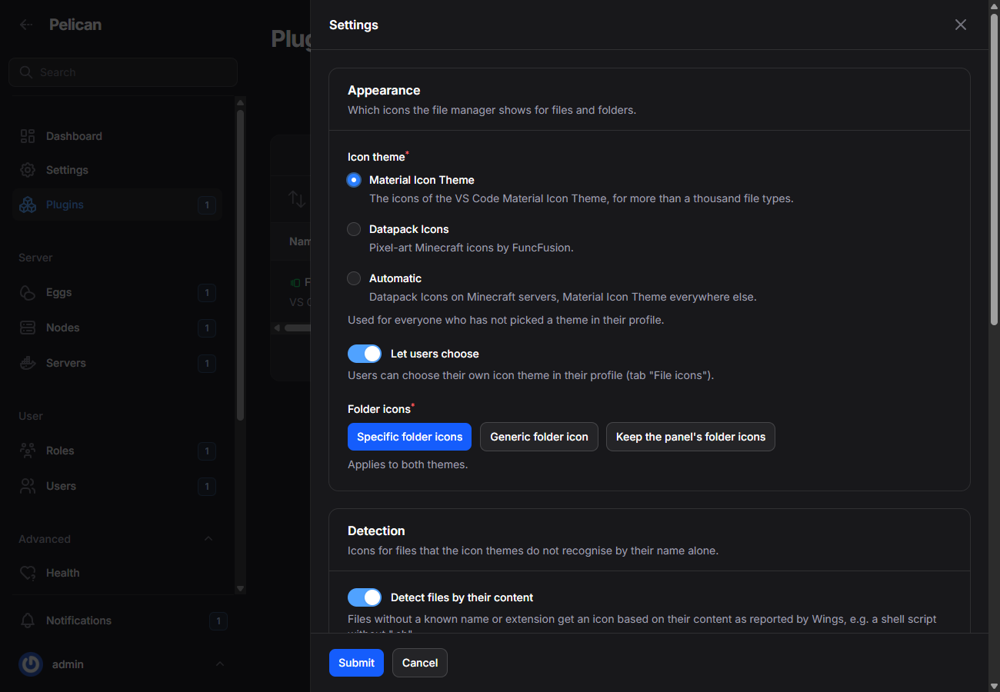

# File Icons

VS Code file icons for the Pelican Panel file manager.

| Material Icon Theme | Datapack Icons |
|---|---|
|  |  |

File Icons replaces the generic file and folder icons in the server file manager with the icons of a VS Code
icon theme. Two themes are included:

- **[Material Icon Theme](https://github.com/material-extensions/vscode-material-icon-theme)**, the popular
  VS Code theme with icons for more than a thousand file types.
- **[Datapack Icons](https://github.com/FuncFusion/mc-dp-icons)** by FuncFusion, pixel-art icons in the style
  of Minecraft, made for data packs and resource packs.

Icons are matched the same way VS Code matches them, so `package.json`, `docker-compose.yml`,
`.github/workflows` or `pack.mcmeta` look just like they do in your editor.

## Features

- Two icon themes, plus an **Automatic** mode that shows Datapack Icons on Minecraft servers and the Material
  Icon Theme everywhere else.
- Every user can pick their own theme in their profile.
- Extra icons for typical game-server files, such as schematics, NBT files, Skript scripts, SourceMod plugins
  and Valve config files.
- Files without a known name or extension get an icon based on their content.
- Icons are part of the page, so even folders with hundreds of files load without extra requests.
- Light and dark mode, English and German.

## Requirements

Pelican Panel 1.0 (tested with `v1.0.0-rc.3`). Nothing else: no Node.js and no build step on your server.

## Installation

1. In the admin area, open **Plugins** and click **Import from URL**.
2. Paste this link and confirm:

   ```text
   https://github.com/laGameTV/pelican-file-icons/releases/latest/download/file-icons.zip
   ```

3. Open the actions menu of **File Icons** and click **Install**.

Open the **Files** page of any server to see the new icons. Pelican installs plugins in a background job, so
your queue worker has to be running.

If you'd rather upload the file yourself, download `file-icons.zip` from the
[latest release](https://github.com/laGameTV/pelican-file-icons/releases/latest) and use **Import from File**
instead.

### Installing with git

```bash
cd /var/www/pelican/plugins
git clone https://github.com/laGameTV/pelican-file-icons.git file-icons
chown -R www-data:www-data file-icons   # your web server user
cd /var/www/pelican
php artisan p:plugin:install file-icons
```

The folder has to be called `file-icons`. Pelican writes the plugin's status into `plugin.json`, so `git status`
shows that file as changed. Don't commit that change, and keep it when you pull (`git stash`, `git pull`,
`git stash pop`).

## Updating

When a new version is released, the plugin list shows an **Update** button. Your settings are kept.

## Choosing your icon theme

Every user can pick their own theme: open your profile, go to the **File icons** tab, choose a theme and save.



| Option | What you see |
|---|---|
| Panel default | The theme the admin selected |
| Material Icon Theme | Material icons on every server |
| Datapack Icons | Datapack Icons on every server |
| Automatic | Datapack Icons on Minecraft servers, the Material Icon Theme everywhere else |

## Settings

Admins find the settings under **Plugins → File Icons → Settings**. A live preview shows the result before
you save.



| Setting | What it does |
|---|---|
| **Icon theme** | The theme for everyone who hasn't picked their own. |
| **Let users choose** | Shows the **File icons** tab in the user profiles. |
| **Folder icons** | Specific icons for folders such as `plugins` or `config`, one generic icon for all folders, or the panel's original folder icons. |
| **Detect files by their content** | Gives files without a known name or extension an icon based on their content, for example a shell script without `.sh`. |
| **Game-server extras** | Icons for game-server files that the VS Code themes don't know. |
| **Framework icons** | A Material Icon Theme option for web-framework files like `*.component.ts`. You can usually leave it as it is. |
| **Custom file and folder icons** | Your own icons for file patterns and folder names, in the same format as the Material Icon Theme settings in VS Code. |

The settings are saved as `FILE_ICONS_*` variables in the panel's `.env`. The
[reference](https://github.com/laGameTV/pelican-file-icons/blob/main/docs/reference.md) lists all variables
and explains the custom icons in detail.

### How Automatic detects Minecraft servers

A server counts as a Minecraft server if its egg has a `minecraft` tag, uses Pelican's Minecraft EULA or Java
version feature, or has a Minecraft server software in its name, such as Paper, Purpur, Spigot, Forge, Fabric,
Velocity, BungeeCord, Bedrock, Nukkit or PocketMine.

## Documentation

- [Reference](https://github.com/laGameTV/pelican-file-icons/blob/main/docs/reference.md): all settings and
  environment variables, custom icons, game-server extras, the content-based fallback, how icons are matched,
  and known limitations.
- [Development](https://github.com/laGameTV/pelican-file-icons/blob/main/docs/development.md): building the
  icon data, running the tests and publishing a release.

## Credits

- [Material Icon Theme](https://github.com/material-extensions/vscode-material-icon-theme) by Material
  Extensions (MIT)
- [Datapack Icons](https://github.com/FuncFusion/mc-dp-icons) by FuncFusion (MIT)
- [Visual Studio Code](https://github.com/microsoft/vscode) by Microsoft (MIT), for its language associations
  and icon matching rules

## License

MIT, see [LICENSE](LICENSE). The licenses of the bundled icon themes are in
[THIRD_PARTY_NOTICES.md](THIRD_PARTY_NOTICES.md). Brand logos in the icons are trademarks of their owners.
Not an official Minecraft product, and not approved by or associated with Mojang or Microsoft.
